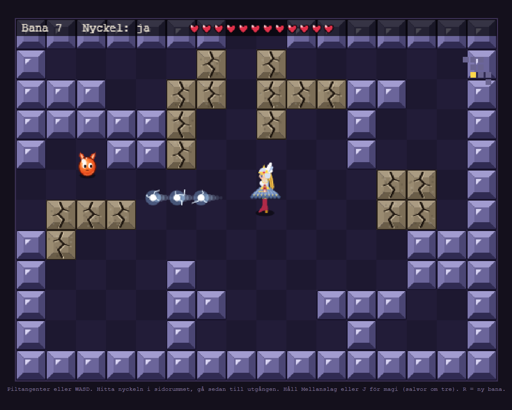
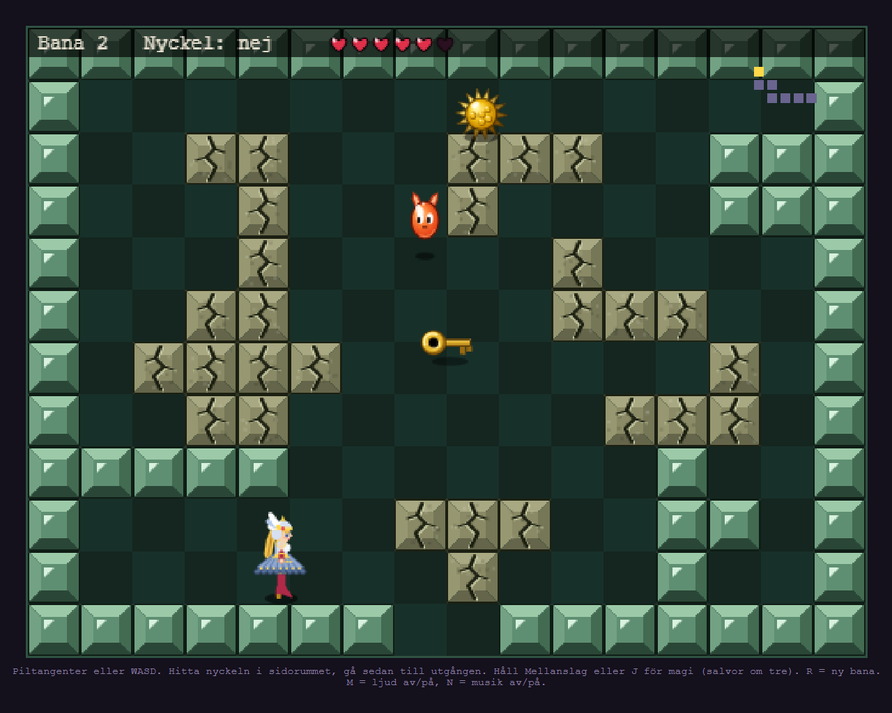
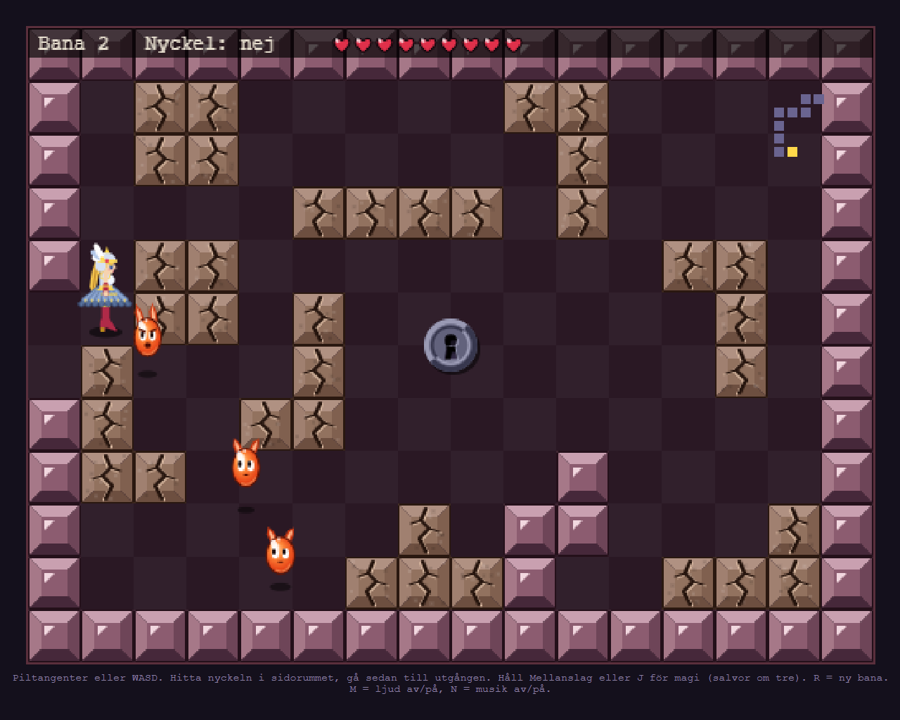

# Valkyria

A retro-style dungeon crawler built as an AI-assisted game development project.

Guide a Valkyrie through procedurally generated labyrinths, recover the key hidden in a side chamber, and reach the exit while fighting enemies with magic.

  
  

## Play Online
 
🎮 **Play Valkyria in your browser**
 
[https://olaelias.github.io/Valkyria/](https://olaelias.github.io/Valkyria/)

## Features

- Procedurally generated dungeons
- 100 levels of increasing difficulty
- Fast arcade-style combat
- Multiple dungeon themes
- Pixel-art inspired visuals
- Synthesized music and sound effects
- Pure HTML, CSS, and JavaScript
- No external assets or dependencies
- Swedish language ingame text

## Controls

| Action | Keys |
|----------|----------|
|WASD / Arrow Keys | Move |
|Space / J / X | Cast magic |
|R | Restart |
|M | Toggle sound |
|N | Toggle music |

## Tech

- HTML5 Canvas
- Vanilla JavaScript
- Web Audio API
- Procedural generation
- AI-assisted development

## Project Goal

Valkyria explores how far a complete game can be developed using AI-assisted workflows while remaining entirely self-contained.

## Play

Open Valkyria.html in a modern browser and press any key to begin.

"Find the key. Escape the labyrinth. Return to Valhalla."
